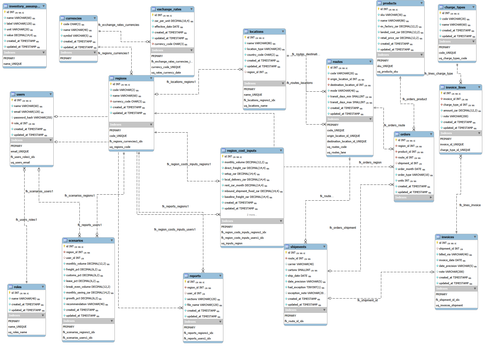
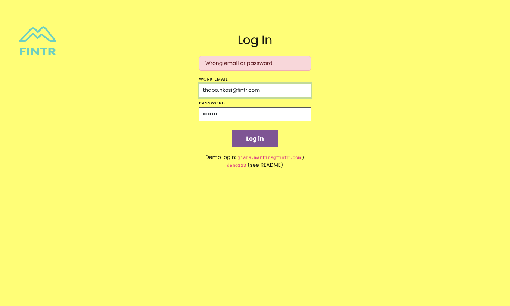
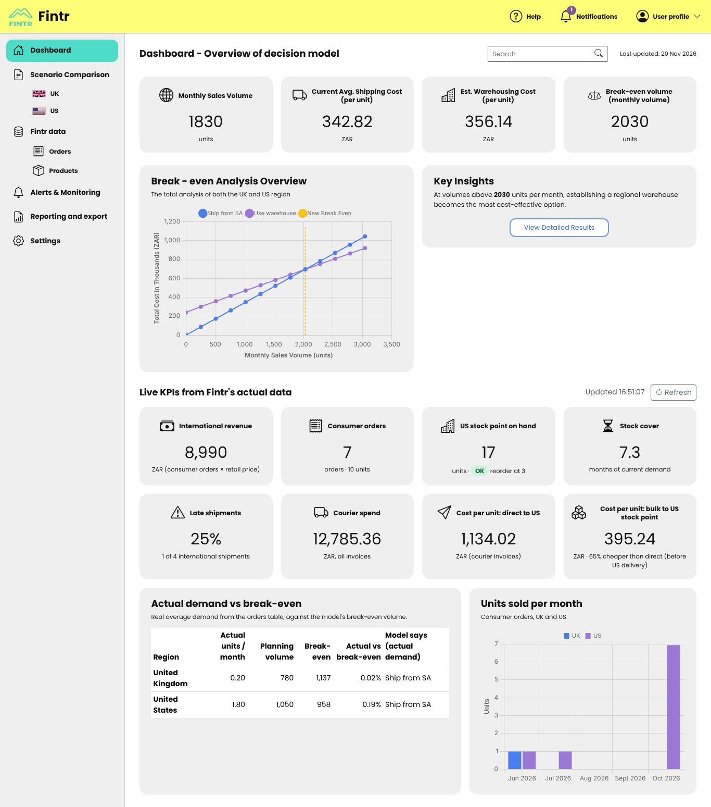
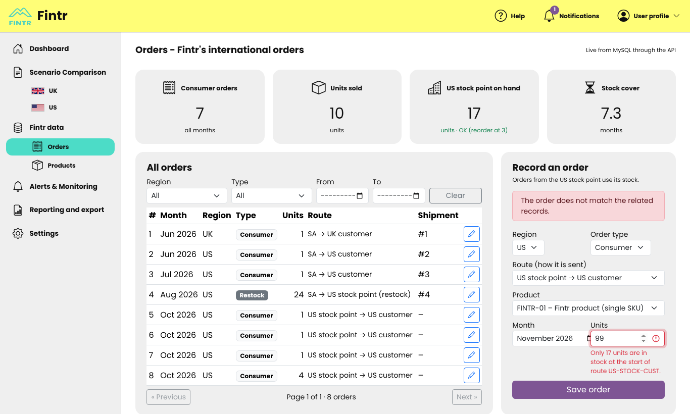
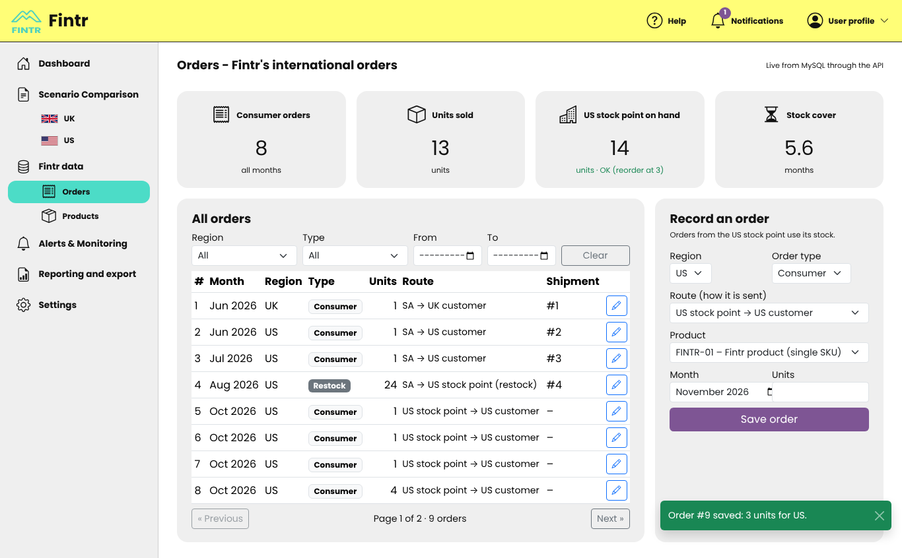
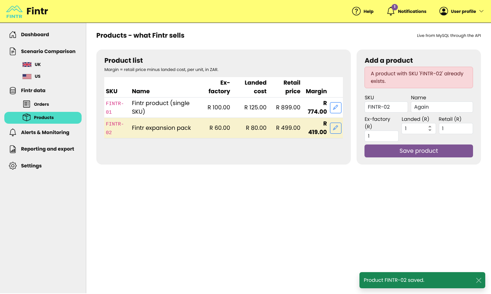
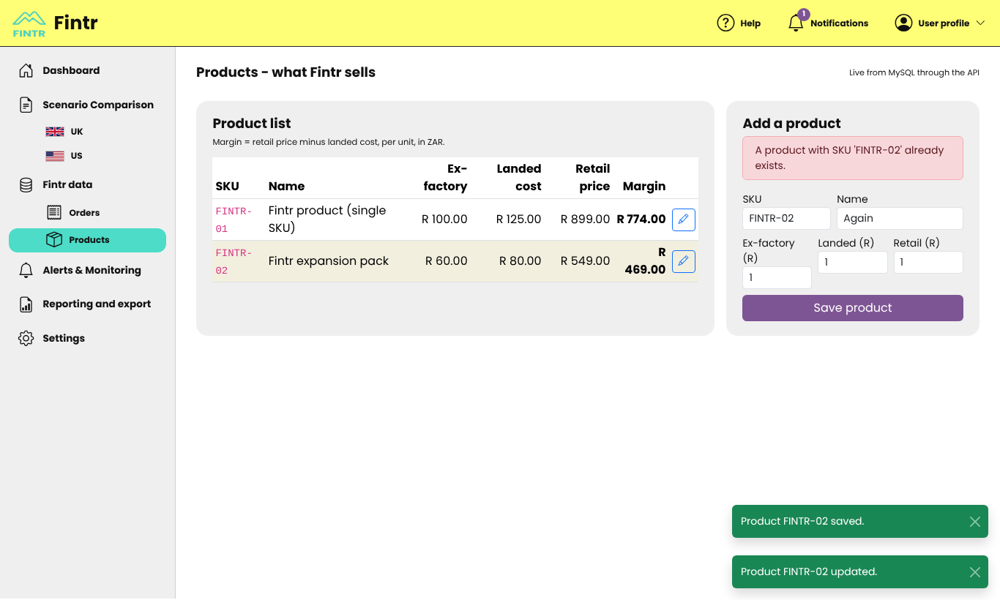
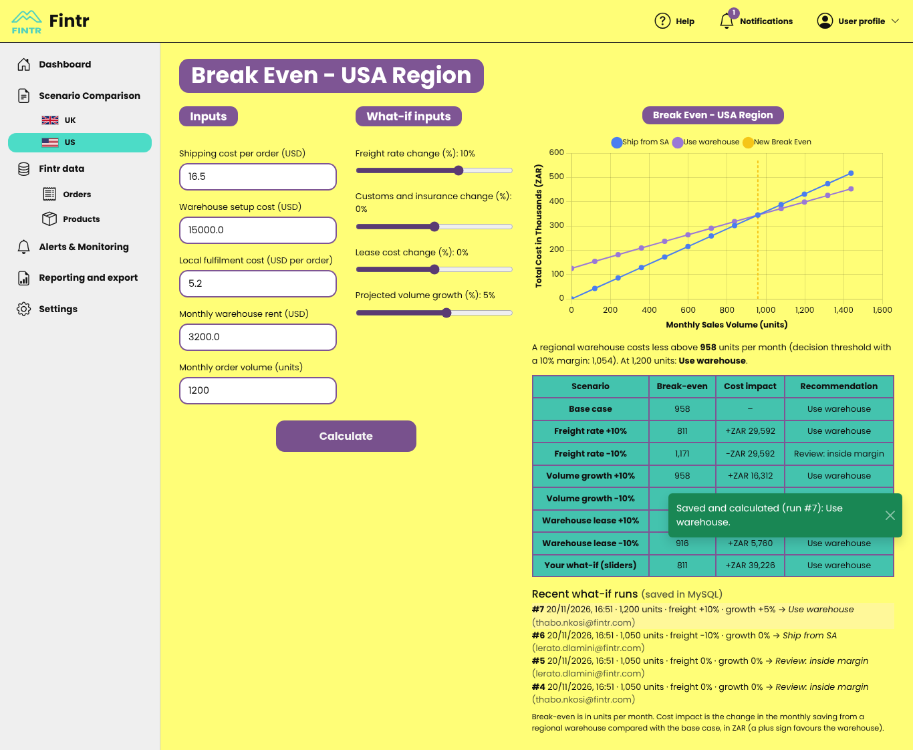
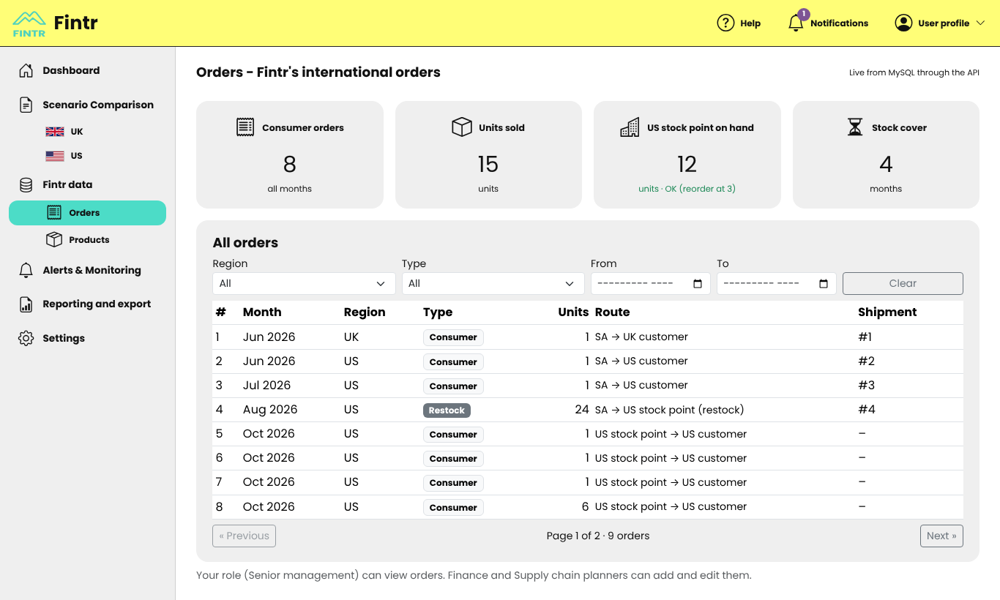

# Fintr Break-Even Tool (BFB 321, Group 9)

## Project Description

This web application helps Fintr decide when it becomes cheaper to hold stock in a regional warehouse (UK or US) than to ship directly from South Africa. For each region it calculates the break-even volume, compares direct shipping and warehouse costs, shows potential monthly savings, and gives a recommendation. Users can change the inputs, run what-if scenarios (freight rate, volume growth and warehouse lease changes), view alerts, and export a PDF report.

Model cost calculations, dashboard charts and reports use ZAR as the common currency. Orders, shipments, courier invoices and products are Fintr's actual data (data pack, 30 October 2026); the break-even cost inputs on the region pages are still illustrative values.

**Stack:** Flask (Python), MySQL, HTML/CSS/Bootstrap, and the break-even model in `models/breakeven.py`.

## Group Members

| Name | Student number | GitHub username |
| --- | --- | --- |
| Farah Hassim | u23536919 | u23536919-cloud |
| Katarina Stamenic | u23635119 | Katarina-09 |
| Keratile Maboka | u24648702 | Keratila-M |

## Task Allocation


| Task | Member(s) |
| --- | --- |
| Frontend pages (Step 1) | Farah Hassim, Keratile Maboka, Katarina Stamenic |
| Break-even model and tests (Step 2) | Farah Hassim, Keratile Maboka, Katarina Stamenic |
| ERD, `schema.sql` and `seed.sql` (Step 3) | Farah Hassim |
| `db.py`, `repository.py` and connecting Flask to MySQL (Step 3) | Farah Hassim |
| REST API, JWT login and API tests (Step 4) | Keratile Maboka |
| Pages wired to the API, live KPIs, real login (Step 5) | Katarina Stamenic |
| README, `.env.example` and setup notes | Farah Hassim, Keratile Maboka, Katarina Stamenic |
| Report and video | Farah Hassim, Keratile Maboka, Katarina Stamenic |

## Database Design (Step 3)

**About the seed data:** the bottom half of `seed.sql` is Fintr's complete data pack (1 product, 8 orders, 4 shipments, 5 invoices, as at 30 October 2026). We did not add made-up orders, because the dashboard KPIs are worked out from this data and the tests check they match the data pack exactly.

The app stores its data in MySQL. The tables are defined in `database/schema.sql` and filled with demo data by `database/seed.sql`.



*Figure 1: Entity relationship diagram of the tables in `database/schema.sql`.*

| Table | Purpose |
| --- | --- |
| `roles` | The three login roles (Finance, Supply chain planner, Senior management) |
| `users` | People who log in (linked to a role) |
| `currencies` | GBP and USD |
| `regions` | UK and US (each linked to a currency) |
| `exchange_rates` | ZAR per 1 GBP/USD, one row per date (newest row is used) |
| `inventory_assumptions` | Settings shared by both regions (unit cost, holding rate, lead time, demand variability, service level) |
| `region_cost_inputs` | The current editable inputs of each region (one row per region) |
| `scenarios` | Every what-if run saved from a region page |
| `reports` | A log of every PDF report generated |
| `products` | Fintr's product: ex-factory (R100), landed (R125) and retail (R899) price |
| `locations` | SA dispatch, the US stock point in Indianapolis, and UK/US customers |
| `routes` | Each lane (e.g. SA → US stock point) with its typical transit days |
| `shipments` | Each international consignment, its carrier, cartons and any customs/delivery exception |
| `invoices` | Each TUNL courier invoice (total = sum of its lines, so it is never stored twice) |
| `charge_types` | Lookup of invoice charge types (courier, protection, duties, clearance, credit, …) |
| `invoice_lines` | The ZAR cost breakdown of each invoice |
| `orders` | Every UK/US order from Jun–Oct 2026 (consumer orders and stock-point restocks) |

The first nine tables hold the model inputs and app activity (their values are still illustrative). The last eight hold **Fintr's actual data** from the data pack (as at 30 October 2026): 8 orders, 4 shipments, 5 invoices totalling R12,785.36, and a 25% (1 of 4) delay rate. Months with no row had zero international orders.

Example: total direct-shipping cost per route

```sql
SELECT rt.code, COUNT(DISTINCT s.id) AS shipments, SUM(l.amount_zar) AS total_zar
FROM shipments s
JOIN routes rt ON rt.id = s.route_id
JOIN invoices i ON i.shipment_id = s.id
JOIN invoice_lines l ON l.invoice_id = i.id
GROUP BY rt.code;
```

Money columns use `DECIMAL`, every table has a primary key and `created_at`/`updated_at`, relationships use foreign keys, and constraints (`NOT NULL`, `UNIQUE`, `CHECK`) protect the data.

## Installation and Setup

You need Python 3.10 or newer and MySQL 8 (or MariaDB 10.5+).

### 1. Get the code

```bash
git clone https://github.com/u23536919-cloud/BFB321_Group_9.git
cd BFB321_Group_9
```

### 2. Create a virtual environment and install the requirements

```bash
python -m venv .venv
.venv\Scripts\activate          # Windows
source .venv/bin/activate       # Mac / Linux
pip install -r requirements.txt
```

If `pip.exe` is blocked on your computer, use `python -m pip install -r requirements.txt` instead.

### 3. Create the MySQL database and user

Log in to MySQL as an administrator (`mysql -u root -p`) and run:

```sql
CREATE DATABASE fintr_breakeven CHARACTER SET utf8mb4;
CREATE DATABASE fintr_breakeven_test CHARACTER SET utf8mb4;
CREATE USER 'fintr_user'@'localhost' IDENTIFIED BY 'choose-a-password';
GRANT ALL ON fintr_breakeven.* TO 'fintr_user'@'localhost';
GRANT ALL ON fintr_breakeven_test.* TO 'fintr_user'@'localhost';
```

### 4. Add your settings

Copy `.env.example` to `.env` and fill in your database user and password (`.env` is ignored by Git and must never be committed):

```bash
copy .env.example .env          # Windows
cp .env.example .env            # Mac / Linux
```

### 5. Build the tables and load the demo data

```bash
python db.py check              # tests the connection
python db.py init               # runs database/schema.sql and database/seed.sql
```

`python db.py init` can be run again at any time to reset the database to the demo data.

### 6. Run the tests and start the app

```bash
python -m pytest
python app.py
```

Open <http://127.0.0.1:5000> and log in with `jiara.martins@fintr.com` / `demo123` (more users under [Test Sign-in](#test-sign-in)). **All 73 tests need the MySQL test database to run in full.** Create it once (`CREATE DATABASE fintr_breakeven_test;`) and set `DB_TEST_NAME` in `.env`. Without it, the 29 database tests are skipped, not failed; run `python -m pytest -rs` to see why a test was skipped.

## REST API (Step 4)

The API is a Flask Blueprint in `api/`, mounted at `/api`. Every request and response is JSON. The full contract (request and response schemas for every endpoint) is in [`docs/openapi.json`](docs/openapi.json): paste it into <https://editor.swagger.io> to browse it.

| File | What it does |
| --- | --- |
| `api/__init__.py` | Creates the blueprint and attaches it to the app |
| `api/routes.py` | The endpoints |
| `api/auth.py` | JWT login tokens and the role checks |
| `api/helpers.py` | Pagination, filters, validation, JSON conversion |
| `api/errors.py` | One JSON error format and the error handlers |

### Endpoints

| Method | Endpoint | Who | What it does |
| --- | --- | --- | --- |
| GET | `/api/health` | anyone | API and database status |
| POST | `/api/auth/login` | anyone | Email + password → JWT token |
| GET | `/api/auth/me` | logged in | The current user and role |
| GET | `/api/regions` | logged in | Both regions: inputs and break-even results |
| GET | `/api/regions/{code}` | logged in | One region (`uk` or `us`) |
| PUT | `/api/regions/{code}/inputs` | Finance, Supply chain planner | Change cost inputs and/or monthly volume |
| GET | `/api/scenarios` | logged in | Saved what-if runs. Filters: `region`, `recommendation` |
| GET | `/api/scenarios/{id}` | logged in | One saved what-if run |
| POST | `/api/scenarios` | Finance, Supply chain planner | Run a what-if (freight/customs/lease/growth %) and save it |
| GET | `/api/products` | logged in | All products |
| GET | `/api/products/{id}` | logged in | One product |
| POST | `/api/products` | Finance, Supply chain planner | Create a product (duplicate SKU → `409`) |
| PUT | `/api/products/{id}` | Finance, Supply chain planner | Change a product (send only what changes) |
| GET | `/api/orders` | logged in | Fintr's actual orders. Filters: `region`, `order_type`, `from`, `to` (YYYY-MM) |
| GET | `/api/orders/{id}` | logged in | One order |
| POST | `/api/orders` | Finance, Supply chain planner | Record a new order |
| PUT | `/api/orders/{id}` | Finance, Supply chain planner | Change an order (send only what changes) |
| GET | `/api/shipments` | logged in | Shipments with invoice totals. Filters: `region`, `route`, `exception` |
| GET | `/api/shipments/{id}` | logged in | One shipment with its invoice cost breakdown |
| GET | `/api/kpis` | logged in | Live dashboard KPIs worked out from MySQL (Step 5) |
| GET | `/api/reports` | logged in | Log of generated PDF reports. Filter: `region` |

**Create, read, update:** products and orders can be created (POST), read one and many (GET) and updated (PUT). Region inputs are read and updated (the two regions are fixed, so they are not created through the API). Scenarios are created and read but not edited, because they are a history of what-if runs.

**Related data stays consistent:** an order's route must deliver to the order's region, its SKU must exist and its shipment must exist (otherwise `400`). A new or changed order immediately updates the region's `actual_demand` (average consumer orders per month) in `GET /api/regions/{code}`, which is what the break-even question is about.

**Pagination:** list endpoints take `?page=1&per_page=20` (max 100) and return `{"data": [...], "pagination": {"page", "per_page", "total", "pages"}}`.

**Roles:** Finance and Supply chain planner can create and change products, orders and region inputs, and run scenarios. Senior management can read everything but gets `403 forbidden` on changes.

**Errors** always look like this (also for 404/405 on unknown `/api` URLs):

```json
{"error": {"status": 400, "code": "validation_failed", "message": "Some fields are not valid.",
           "details": {"monthly_volume": "Must be 0 or more."}}}
```

| Status | Code | When |
| --- | --- | --- |
| 400 | `validation_failed`, `invalid_input`, `bad_request`, `bad_query`, `inconsistent`, `bad_reference` | A field is missing, the wrong type or out of range; the body is not JSON; a bad filter or page value; or the record does not match related records |
| 401 | `unauthorized`, `invalid_token`, `token_expired`, `invalid_credentials` | Not logged in or wrong password |
| 403 | `forbidden` | Your role cannot do this |
| 404 | `not_found` | Unknown id, region or URL |
| 405 | `method_not_allowed` | Wrong HTTP method |
| 409 | `duplicate` | The value must be unique (for example a SKU that already exists) |
| 503 | `database_unavailable`, `database_off` | MySQL is down or `USE_DATABASE=false` |
| 500 | `internal_error` | Unexpected error (full details go to the log, not the client) |

**Logging:** every API call is logged as one line, e.g. `API GET /api/orders?region=us -> 200 (4 ms, user jiara.martins@fintr.com)`. Failed database writes are rolled back and logged (`db.py`), and unexpected errors are logged with the full traceback but the client only sees a short JSON message.

### Try it (with `python app.py` running)

```bash
# 1. log in and copy the "token" from the reply
curl -X POST http://127.0.0.1:5000/api/auth/login -H "Content-Type: application/json" -d "{\"email\":\"jiara.martins@fintr.com\",\"password\":\"demo123\"}"

# 2. use it
curl http://127.0.0.1:5000/api/regions/uk -H "Authorization: Bearer PASTE_TOKEN_HERE"
curl "http://127.0.0.1:5000/api/orders?region=us&per_page=3" -H "Authorization: Bearer PASTE_TOKEN_HERE"
curl -X POST http://127.0.0.1:5000/api/scenarios -H "Authorization: Bearer PASTE_TOKEN_HERE" -H "Content-Type: application/json" -d "{\"region\":\"us\",\"freight_pct\":10}"
```

These commands are for Command Prompt (cmd) or Mac/Linux. VS Code's terminal on Windows is PowerShell, where `curl` means something else, so it is easier to use the free **Thunder Client** extension in VS Code: make a request, pick the method, paste the URL, put the JSON in *Body*, and the token in *Auth → Bearer*.

## Integration and Core Features (Step 5)

The pages now talk to the REST API with `fetch` (shared helpers in `static/js/api.js`). When you log in, the app creates an API token for you and puts it in the page, so every call is checked by the same login and role rules as the API.

### End-to-end flows

Each flow goes from a screen, through the API, to MySQL and back to the screen without a page reload.

| # | Flow (who) | Screen | API calls | MySQL tables | Result on screen |
| --- | --- | --- | --- | --- | --- |
| 1 | **Run the break-even model** (Finance, Supply chain planner) | UK or US page: change inputs, volume and what-if sliders, press **Calculate** | `PUT /api/regions/{code}/inputs`, then `POST /api/scenarios`, then `GET /api/scenarios?region=` | `region_cost_inputs`, `scenarios` | Chart, recommendation, sensitivity table and "Recent what-if runs" update; confirmation message. **The Step 2 model drives this flow.** |
| 2 | **Record or edit an order** (Finance, Supply chain planner) | Orders page: *Record an order* form, or the pencil button | `POST /api/orders` or `PUT /api/orders/{id}`, then `GET /api/orders` and `GET /api/kpis` | `orders` (checked against `routes`, `products`, `shipments`) | New row appears and is highlighted; stock on hand, stock cover and order totals update. **An order sent from the US stock point reduces its stock**, and one that needs more units than are in stock is refused. |
| 3 | **Add or edit a product** (Finance, Supply chain planner) | Products page: *Add a product* form, or the pencil button | `POST /api/products` or `PUT /api/products/{id}`, then `GET /api/products` | `products` | Row appears or updates, including the margin; a duplicate SKU shows a clear message. |

Also wired to the API: the dashboard's live KPIs (`GET /api/kpis`) and the product list in the order form.

### Live metrics and KPIs

The dashboard's **Live KPIs** section is worked out from MySQL on every load (and by the *Refresh* button), so it changes as soon as the data changes:

| KPI | How it is worked out |
| --- | --- |
| International revenue | Consumer order units × the product's retail price |
| Consumer orders and units | Count and sum of consumer orders |
| US stock point on hand | Restock units in minus units sent to customers from the stock point |
| Stock status and reorder point | Reorder point = average monthly units out × restock lead time (28 days ÷ 30). Shows *OK*, *Restock now* or *Out of stock* |
| Stock cover | Units on hand ÷ average monthly units out |
| Late shipment rate | Shipments with a customs or delivery exception ÷ all shipments |
| Courier spend | Sum of all courier invoice lines |
| Cost per unit, direct vs bulk to the US stock point | Invoice totals on each route ÷ units carried |
| Actual demand vs break-even (table) | Average consumer units per month against the model's break-even volume, and what the model recommends at the **actual** demand |
| Units sold per month (chart) | Consumer units per month, UK and US |

The original KPI tiles and break-even chart at the top of the dashboard still show the model at the planning volumes from the region pages.

### Loading, empty and error states

Every API-driven table or box shows a spinner while it loads, a message when there is nothing to show (for example "No orders match these filters"), and an error message with a **Try again** button when a call fails. Validation errors from the API appear under the field they belong to. If the login token expires, the page says so and returns to the login page.

### Screenshots

| | |
| --- | --- |
|  *Figure 2: Login with a real password check* |  *Figure 3: Dashboard with live KPIs from MySQL* |
|  *Figure 4: Flow 2, an order larger than the stock on hand is refused* |  *Figure 5: Flow 2, the saved order appears and stock drops from 17 to 14* |
|  *Figure 6: Flow 3, a duplicate SKU is refused* |  *Figure 7: Flow 3, the edited price and new margin* |
|  *Figure 8: Flow 1, the model runs through the API and the run is saved* |  *Figure 9: Senior management sees the data without edit controls* |

## Test Sign-in

The website and the API both check real passwords (stored only as a salted hash in `users.password_hash`). Every seeded user has the password **`demo123`**:

| Email | Password | Role | Can do |
| --- | --- | --- | --- |
| jiara.martins@fintr.com | demo123 | Finance | Everything |
| thabo.nkosi@fintr.com | demo123 | Supply chain planner | Everything |
| lerato.dlamini@fintr.com | demo123 | Senior management | View only (no add/edit buttons; the API answers `403`) |

With `USE_DATABASE=false` (demo mode, no MySQL) there are no accounts: any email and password work and you pick a role.

## Backup, Restore and Rollback

```bash
mysqldump -u fintr_user -p fintr_breakeven > backup.sql     # back up
mysql -u fintr_user -p fintr_breakeven < backup.sql         # restore
python db.py init                                           # reset to the demo data (repeatable)
```

**Changing the database safely (rollback plan):**

1. Back up first: `mysqldump -u fintr_user -p fintr_breakeven > backup.sql`.
2. Make the change in `database/schema.sql` (and `seed.sql`), then test it on the **test** database: `python -m pytest`.
3. Apply it with `python db.py init` (or run only the new `ALTER TABLE` statement in MySQL to keep live data).
4. **If anything fails:** restore the backup (`mysql -u fintr_user -p fintr_breakeven < backup.sql`) and undo the code change with `git revert <commit>`.

Every write in the app already runs in a transaction: if a statement fails, `db.py` rolls the whole change back and logs it.

**Logging:** every request to the API and every database problem is logged with the time, level and message (console by default; set `LOG_FILE` in `.env` to also keep a log file). `.env`, log files and backups are in `.gitignore`.

## Project Structure

- `app.py`: creates the Flask app and registers the two blueprints (application factory)
- `pages.py`: the website pages (Blueprint "pages")
- `services.py`: shared helpers used by the pages and the API
- `config.py`: development, testing and production settings
- `db.py`: MySQL connection and the `init` command
- `repository.py`: every SQL query (parameterised)
- `models/breakeven.py`: standalone break-even model (formulae, units and assumptions are in the module docstring)
- `database/schema.sql`, `database/seed.sql`: tables and demo data
- `docs/`: ERD image created in MySQL workbench, , and `openapi.json` (the API contract)
- `templates/` and `static/`: Bootstrap frontend
- `api/`: the REST API blueprint (Step 4)
- `static/js/api.js`: the browser helpers that call the API, show loading/empty/error states and messages (Step 5)
- `templates/orders.html`, `templates/products.html`: the Step 5 pages (filled from the API in the browser)
- `docs/screenshots/`: screenshots of the end-to-end flows
- `report_pdf.py`: builds the PDF report
- `tests/`: unit tests (model, settings, API, Step 5) and database tests (`test_database.py` and the database halves of `test_api.py` and `test_step5.py`)
- `.env.example`: template for your private `.env` file

## Notes

Step 4 added the REST API (`api/`). Step 5 wired the pages to it (three end-to-end flows, live KPIs, real login). The model inputs on the region pages (costs and planning volumes) are still the illustrative values from Step 2; the dashboard's live KPIs use Fintr's actual data and show what the model recommends at the real demand.
